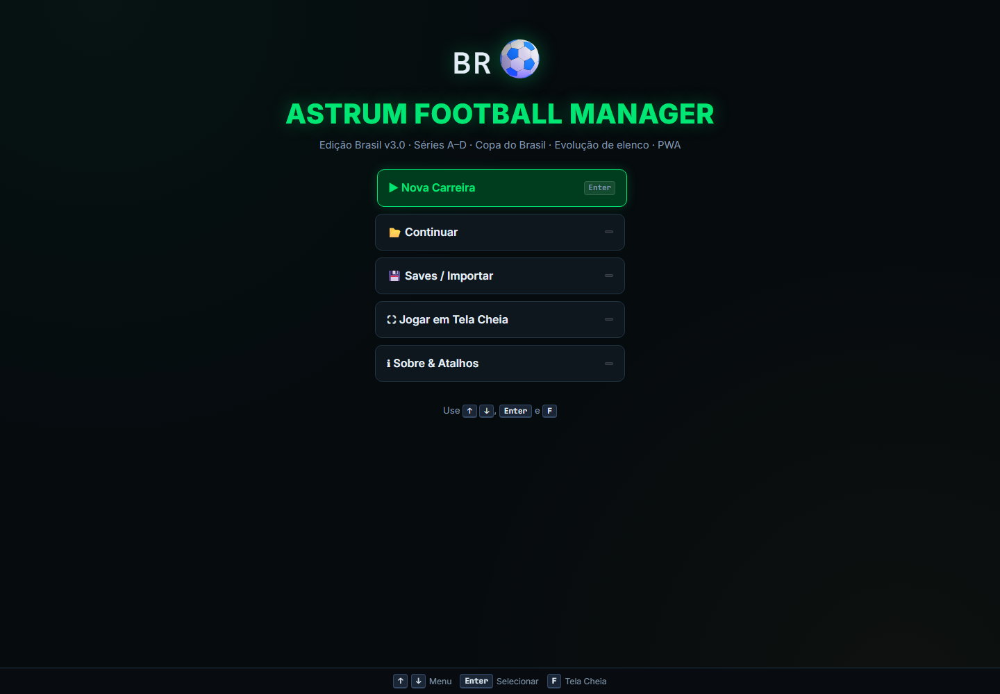
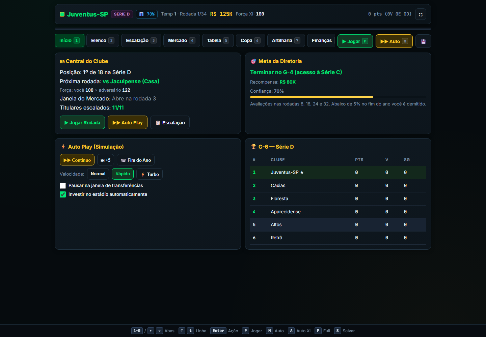
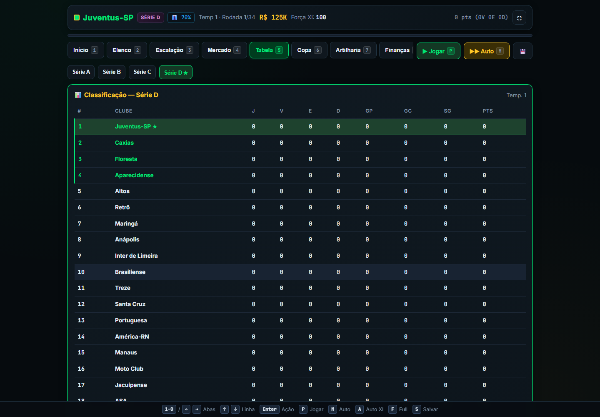

# 🇧🇷⚽ Astrum Football Manager — Edição Brasil **v3.0**

Manager de futebol no navegador: **Brasileirão (Séries A–D)**, **Copa do Brasil**, evolução de elenco e PWA offline. Arquivo de jogo único (`index.html`), sem build.

## Screenshots

<p align="center">
  
  
</p>
<p align="center">
  
</p>

## Novidades da v3.0

| Área | O que mudou |
|------|-------------|
| 🔁 **Pirâmide completa** | G-4 sobe e Z-4 desce em *todas* as divisões (antes só o seu clube se movia) |
| 📅 **Calendário real** | Turno e returno (34 rodadas) nas 4 séries; antes as séries da IA repetiam 9 confrontos |
| 📈 **Evolução de elenco** | Jovens crescem (potencial oculto), veteranos declinam e se aposentam; revelações da base |
| 👤 **Agentes livres** | Contratação a qualquer rodada (luvas = 8% do valor) + dispensa de jogadores |
| ⚖️ **Equilíbrio tático** | Goleiro e posições da formação afetam a força; formações alteram gols esperados |
| ⚽ **Motor de jogo** | Gols com minuto e assistência coerentes com a artilharia; Copa com pênaltis e desgaste do XI |
| 💼 **Demissão** | Propostas de outros clubes; carreira, histórico e troféus continuam |
| 📊 **Interface** | Tabela das 4 séries, artilharia por divisão/Copa, histórico de temporadas, filtros de mercado, forma recente |
| 💾 **Saves** | 3 slots, autosave, exportar/importar `.json`; saves da v2.x migram automaticamente |
| 📲 **PWA de verdade** | `manifest.webmanifest`, ícones, service worker com atualização e instalação |
| ♿ **Acessibilidade** | Zoom liberado, foco visível, Tailwind CDN removido (jogo 100% offline) |

### Correções
- Rebaixamento deixava divisões com 17/19 clubes e um time jogando **contra si mesmo**.
- Bônus de formação beneficiava o adversário quando você jogava fora.
- Prêmio da Copa pago com uma fase de atraso; gols da Copa contavam na artilharia do Brasileirão.
- Lesões de 1 rodada se curavam na mesma rodada.
- Nome de clube com HTML/aspas (e saves importados) agora são validados.

## Jogar
Abra `index.html` no navegador **ou** publique no GitHub Pages (Settings → Pages → `main` / root).
Para **instalar como app** é preciso servir por `https://` ou `localhost` (o Pages já serve).

- **Android:** Chrome → ⋮ → *Instalar app*
- **iPhone:** Safari → Compartilhar → *Adicionar à Tela de Início*

## Atalhos (PC)
`P` jogar · `M` auto · `A` Auto XI · `S` salvar · `F` tela cheia · `1`–`9`/`0` abas · `←` `→` abas · `↑` `↓` linhas · `Tab` seções do mercado · `Esc` parar/voltar

## Estrutura
```
astrum-fm-brasil/
├── index.html            # jogo
├── sw.js                 # service worker
├── manifest.webmanifest  # PWA
├── icons/                # 192, 512, maskable, apple-touch
├── README.md  LICENSE  .gitignore
```

## Licença
MIT — veja `LICENSE`.
