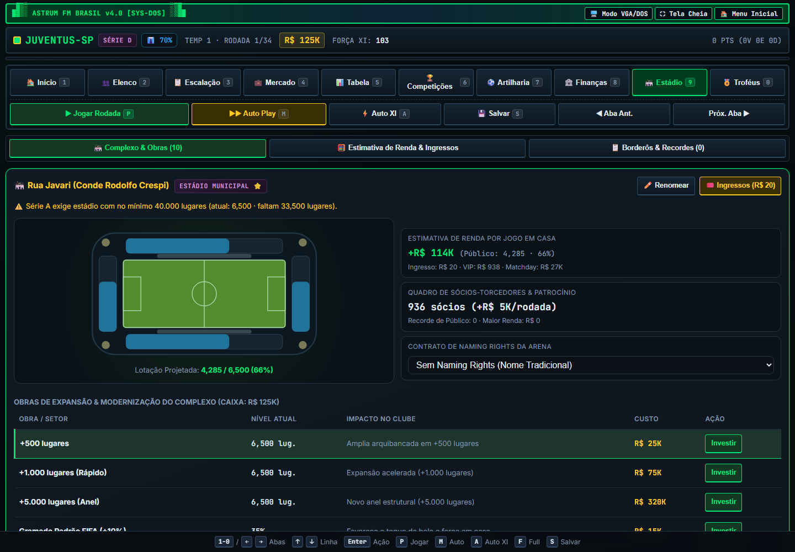
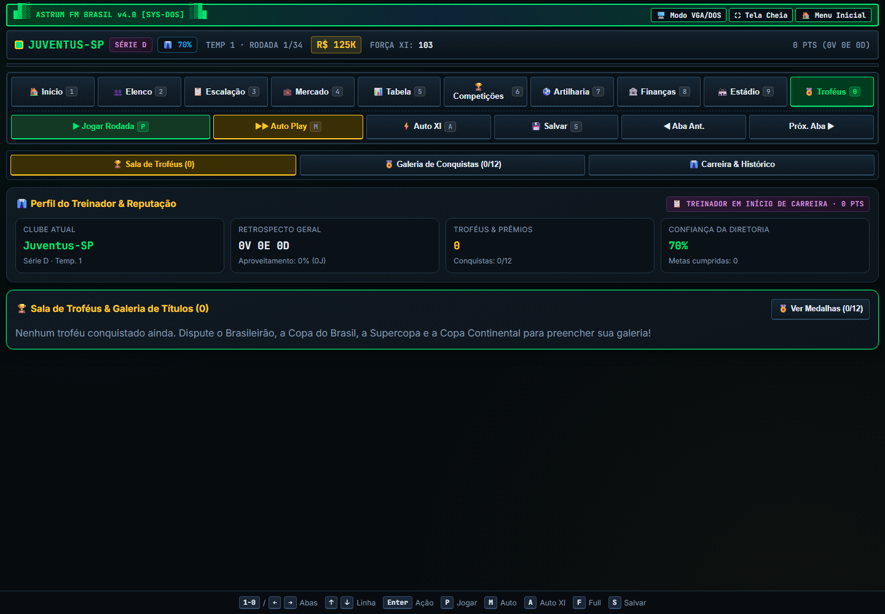

# 🇧🇷⚽ Astrum Football Manager — Edição Brasil v4.0

**Assuma um clube da Série D, monte seu time e leve-o até a elite do futebol brasileiro.** Planeje escalações, negocie jogadores, administre o caixa e o estádio e dispute campeonatos nacionais e continentais. O jogo roda no navegador, funciona offline depois de carregado e não precisa de instalação nem de etapa de build.

## Índice

- [Como jogar](#como-jogar)
- [Começando uma carreira](#começando-uma-carreira)
- [Ciclo de cada rodada](#ciclo-de-cada-rodada)
- [Elenco e escalação](#elenco-e-escalação)
- [Competições e progressão](#competições-e-progressão)
- [Mercado da bola](#mercado-da-bola)
- [Finanças e estádio](#finanças-e-estádio)
- [Treinador, diretoria e conquistas](#treinador-diretoria-e-conquistas)
- [Controles](#controles)
- [Saves e instalação](#saves-e-instalação)
- [Capturas de tela](#capturas-de-tela)
- [Histórico de versões](#histórico-de-versões)

## Como jogar

1. Abra `index.html` ou acesse a versão publicada pelo GitHub Pages, se o Pages estiver ativado no repositório.
2. Escolha **Nova Carreira**, defina o clube, a dificuldade, o slot e as cores do uniforme.
3. Confira a **Escalação** e escolha seus 11 titulares. Se preferir, use **Auto XI**.
4. Na tela **Início**, leia o próximo adversário, a meta da diretoria e o resumo da temporada.
5. Selecione **Jogar Rodada** ou pressione `P` para simular uma rodada. Repita o ciclo, ajuste o time e administre o clube até o fim do campeonato.

Você começa na **Série D**. O objetivo de longo prazo é subir de divisão e conquistar títulos. Resultados, orçamento, elenco e confiança da diretoria persistem entre temporadas.

## Começando uma carreira

A tela **Nova Carreira** permite escolher um dos clubes sugeridos ou digitar outro nome, definir a dificuldade, escolher um dos três slots de save e personalizar as cores do uniforme.

| Dificuldade | Caixa inicial | Como funciona |
|---|---:|---|
| Fácil | R$ 200 mil | Mais folga para salários, contratações e obras no início. |
| Normal | R$ 125 mil | Orçamento equilibrado. |
| Difícil | R$ 70 mil | Caixa apertado; acompanhe as despesas desde a primeira rodada. |

Todas as opções começam na Série D com um elenco de 20 atletas e estádio de 6.500 lugares. A dificuldade também influencia a meta da diretoria quando você chegar à Série A.

## Ciclo de cada rodada

Uma temporada tem **34 rodadas**. Em cada rodada o jogo:

- simula as partidas da sua divisão e atualiza resultados e classificação;
- verifica se há jogo de copa naquela data;
- desconta salários e manutenção e registra as receitas;
- atualiza energia, lesões, suspensões e a condição dos jogadores;
- abre o mercado nas rodadas previstas e reavalia a confiança da diretoria a cada oito rodadas.

Você pode jogar rodada por rodada para acompanhar cada partida ou ativar **Auto Play** com `M`. O modo automático usa o Auto XI se não houver 11 titulares disponíveis; também é possível ajustar a velocidade e parar a simulação. Ao final da 34ª rodada, avance novamente para fechar a temporada, receber prêmios, conferir a evolução do elenco e iniciar o próximo ano.

A tabela usa pontos, vitórias e saldo de gols como critérios de classificação. Ao fim do campeonato, os quatro primeiros das Séries D, C e B sobem; os quatro últimos das Séries A, B e C caem. A Série A não tem divisão superior e a Série D não tem rebaixamento.

## Elenco e escalação

A tela **Elenco** lista posição, idade, nota, forma, energia, gols, assistências, salário e situação de cada atleta. O elenco aceita até **30 jogadores**. Lesões e suspensões impedem a escalação enquanto durarem; atletas reservas recuperam energia mais rapidamente.

Na tela **Escalação**, selecione até 11 titulares. A equipe precisa ter um goleiro quando há um disponível e pode usar no máximo **cinco estrangeiros** no XI. Jogadores fora de posição e uma formação desequilibrada reduzem a força da equipe. Nota, forma e energia também afetam o desempenho.

O jogo oferece cinco formações, cada uma com um perfil diferente:

| Formação | Perfil |
|---|---|
| 4-4-2 | Equilibrada |
| 4-3-3 | Mais ofensiva |
| 3-5-2 | Prioriza posse de bola |
| 4-2-3-1 | Mais controle |
| 5-3-2 | Mais defensiva |

A **força do XI**, o goleiro, a distribuição de posições e a formação influenciam a simulação da partida. Use **Auto XI** para preencher a equipe rapidamente e depois faça ajustes manuais se quiser priorizar uma tática ou poupar atletas.

A cada fim de temporada, os jogadores envelhecem e podem evoluir, perder nota, se aposentar ou abrir espaço para jovens da base. O nível do centro de formação contribui para a geração de novos atletas.

## Competições e progressão

- **Brasileirão — Séries A, B, C e D:** 18 clubes em cada divisão, turno e returno, 34 rodadas. A tabela, forma recente e estatísticas ficam nas telas **Tabela** e **Artilharia**.
- **Copa do Brasil:** torneio eliminatório com 64 clubes e seis fases, disputadas nas rodadas 5, 10, 15, 20, 25 e 30. Avançar de fase gera premiação; empates podem ser decididos na prorrogação ou nos pênaltis.
- **Supercopa do Brasil:** partida anual entre os campeões da Série A e da Copa do Brasil, programada para a rodada 3.
- **Copa Continental (Libertadores):** torneio eliminatório de 16 clubes. A classificação é obtida pelo G-4 da Série A ou pelo título da Copa do Brasil; as fases acontecem nas rodadas 8, 16, 24 e 32.

No fim da temporada, o jogo calcula as posições, distribui premiações, registra campeões e estatísticas individuais e aplica acessos e rebaixamentos. O artilheiro da divisão e o líder de assistências também podem render prêmios ao seu clube.

## Mercado da bola

A aba **Mercado** reúne as opções de contratação, venda e agentes livres.

- O mercado regular abre a cada três rodadas. Há limite de **cinco negociações por janela**.
- Use o filtro de posição e a opção **Só jogadores que cabem no caixa** para encontrar atletas dentro do orçamento. As propostas podem ser aceitas ou recusadas pelo clube vendedor.
- Na venda, você define o valor pedido; a negociação depende de haver clubes interessados e de aceitarem o preço.
- **Agentes livres** podem ser contratados em qualquer rodada. Não há taxa de transferência, mas há luvas equivalentes a 8% do valor do atleta e o salário passa a ser pago por rodada.
- Dispensar um jogador custa uma multa de seis salários. Mantenha pelo menos 12 atletas no elenco ao dispensar e 11 para vender.

Considere o custo total do atleta: taxa ou luvas, salário por rodada e espaço disponível no elenco. A folha salarial é cobrada durante a temporada.

## Finanças e estádio

A tela **Finanças** mostra o caixa, as receitas, as despesas e uma projeção para o fim da temporada. Em jogos em casa, a renda pode incluir ingressos, camarotes VIP, bares e loja. Sócios-torcedores, patrocínio e contratos de naming rights contribuem com receitas por rodada. Salários e manutenção do complexo são despesas recorrentes.

Na tela **Estádio**, você pode:

- acompanhar o diagrama da arena e sua capacidade;
- investir em arquibancadas, gramado, instalações, camarotes, iluminação, departamento médico, imprensa e centro de formação;
- definir o preço do ingresso e comparar cenários de jogo comum, clássico, copa e final;
- usar os perfis de preço popular, equilibrado, receita máxima ou jogo grande;
- consultar projeções de público, ocupação, renda e lucro líquido;
- renomear o estádio, negociar naming rights elegíveis e revisar borderôs e recordes de público.

Preço, capacidade, desempenho do clube e estrutura do estádio afetam a estimativa de público e renda. Uma ocupação alta pode dar bônus de força como mandante. Alguns contratos e objetivos exigem capacidade e nível de imprensa mínimos; subir à Série A com estádio abaixo de 40 mil lugares pode gerar uma taxa de adequação.

## Treinador, diretoria e conquistas

A diretoria define uma meta de temporada, revisa o desempenho nas rodadas 8, 16, 24 e 32 e altera a confiança de acordo com sua posição na tabela. Cumprir a meta rende bônus financeiro e confiança. Terminar muito distante dela reduz a confiança; se ela chegar a 5% ou menos no fim da temporada, você pode ser demitido. Nesse caso, aceite uma das propostas de outros clubes para continuar a carreira; seu histórico e suas conquistas são mantidos.

A aba **Troféus** reúne títulos, histórico de temporadas, perfil do treinador, reputação e **12 conquistas** desbloqueáveis. Títulos incluem as quatro divisões, Copa do Brasil, Supercopa, Copa Continental, acesso, prêmios individuais e expansão do estádio.

## Controles

| Tecla | Ação |
|---|---|
| `1` a `9` | Abrir Início, Elenco, Escalação, Mercado, Tabela, Competições, Artilharia, Finanças ou Estádio |
| `0` | Abrir Troféus |
| `←` / `→` | Ir para a aba anterior ou seguinte |
| `↑` / `↓` | Mover a seleção nas listas e tabelas |
| `Enter` | Ativar o item selecionado, escalar atleta ou investir no item selecionado |
| `P` | Jogar a rodada ou fechar a temporada |
| `M` | Iniciar ou parar o Auto Play |
| `A` | Escalar automaticamente o melhor XI disponível |
| `S` | Salvar a carreira atual |
| `F` | Alternar tela cheia |
| `Tab` | Alternar entre contratar, vender e agentes livres no Mercado |
| `Esc` | Parar o Auto Play, voltar ao Início ou retornar ao menu |

No celular, use os botões na tela. O menu inferior mantém os comandos principais disponíveis durante a carreira.

## Saves e instalação

O jogo salva automaticamente após criar a carreira e avançar rodadas. Também há salvamento manual com `S` e **três slots** para manter carreiras diferentes. Em **Saves / Importar**, você pode carregar, exportar um backup `.json` ou importar um arquivo de save em outro dispositivo. Saves compatíveis da versão 2.x são migrados automaticamente.

O jogo pode ser aberto diretamente por `index.html`. Para instalar como aplicativo e usar o service worker, sirva a página por HTTPS (por exemplo, GitHub Pages) ou em `localhost`.

- **Android:** abra no Chrome e escolha *Instalar app* ou *Adicionar à tela inicial*.
- **iPhone:** abra no Safari, toque em *Compartilhar* e escolha *Adicionar à Tela de Início*.

## Capturas de tela

<p align="center">
  
  
</p>
<p align="center">
  
  
</p>
<p align="center">
  
</p>

## Histórico de versões

### v4.0

- Complexo de estádio ampliado, simulador de renda, preço de ingressos, sócios e contratos de naming rights.
- Supercopa do Brasil, Copa Continental, premiações por colocação, reputação, galeria de troféus e conquistas.

### v3.0

- Calendário de 34 rodadas, acessos e rebaixamentos em todas as divisões, evolução de jogadores, agentes livres e saves com exportação e importação.
- Melhorias na simulação, interface, acessibilidade e funcionamento offline.

## Estrutura do projeto

```text
index.html             Jogo completo
sw.js                  Service worker do PWA
manifest.webmanifest   Configuração de instalação
icons/                 Ícones do aplicativo
screenshots/           Capturas usadas neste manual
LICENSE                Licença MIT
```

## Licença

MIT. Consulte o arquivo [LICENSE](LICENSE).
