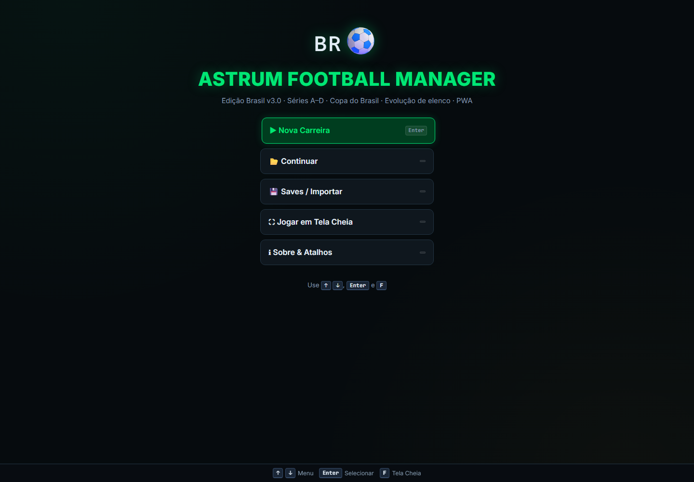
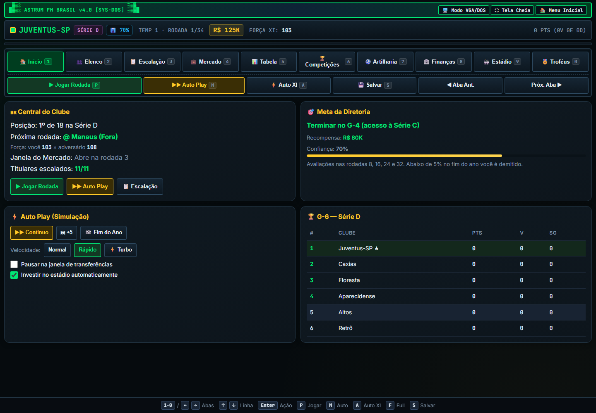
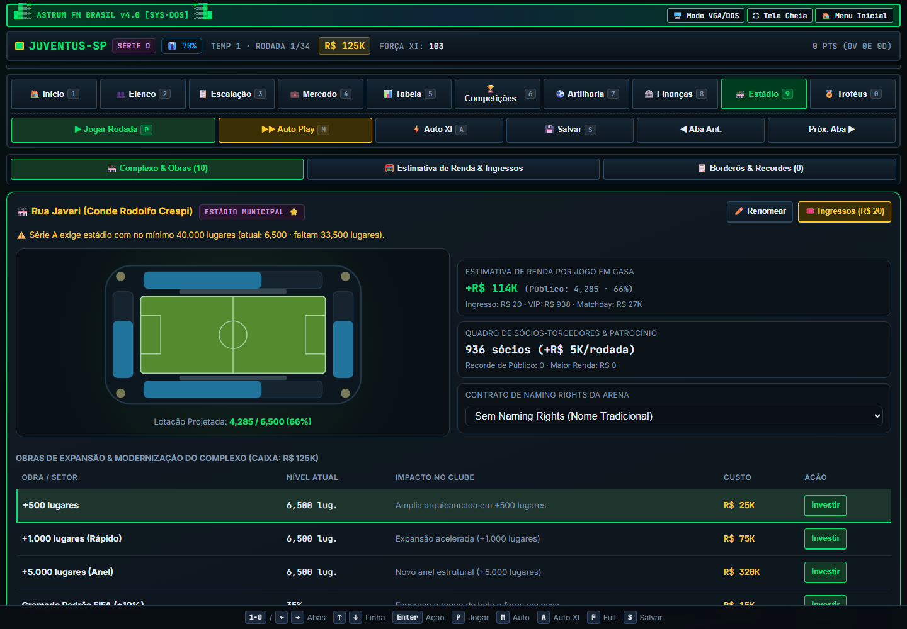
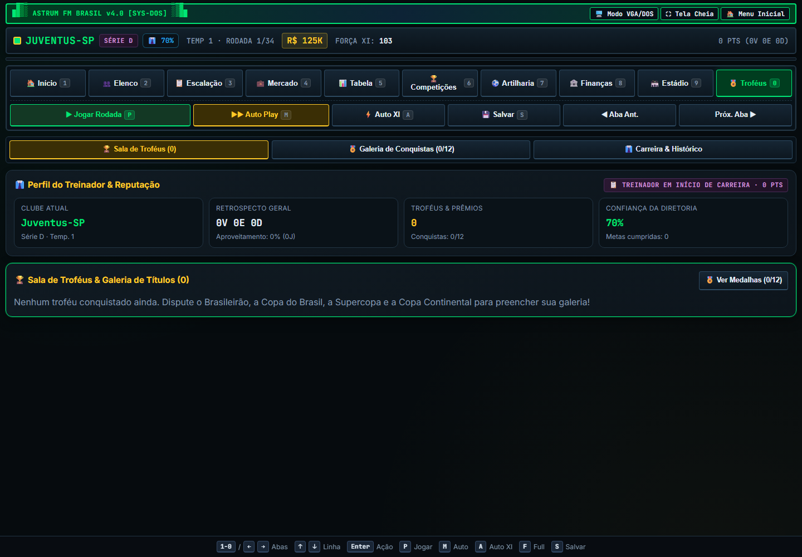
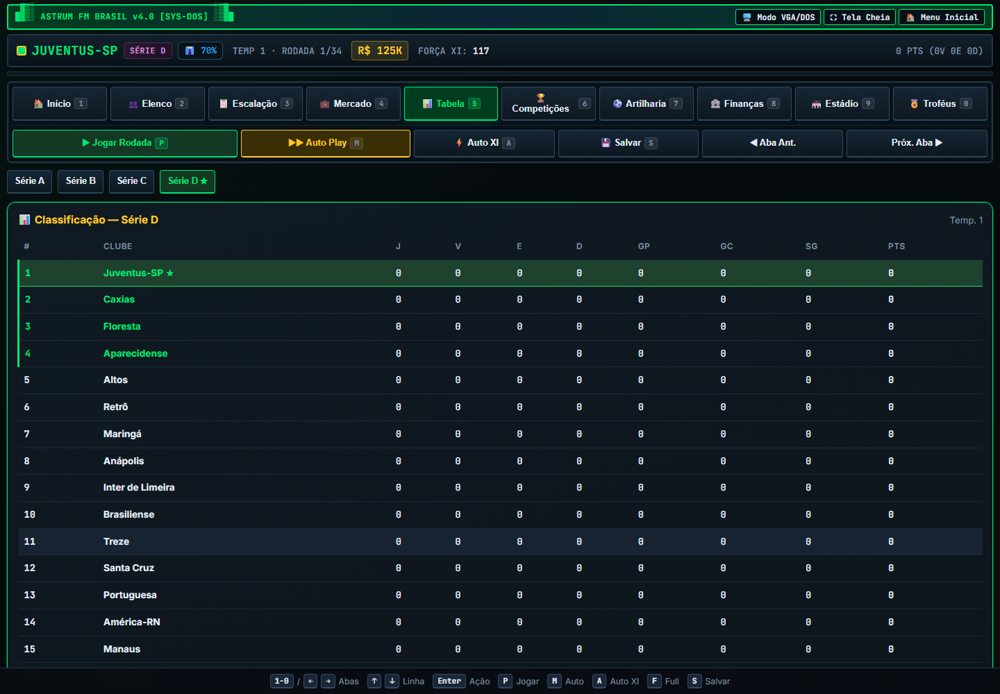

# 🇧🇷⚽ Astrum Football Manager — Edição Brasil v5.0

**Assuma um clube da Série D, monte seu time e leve-o até a elite do futebol brasileiro.** Planeje escalações, negocie jogadores, despache olheiros internacionais em busca de astros mundiais, administre o caixa e o estádio e dispute campeonatos nacionais e continentais. O jogo roda no navegador, funciona offline depois de carregado e não precisa de instalação nem de etapa de build.

## Índice

- [Como jogar](#como-jogar)
- [Começando uma carreira](#começando-uma-carreira)
- [Ciclo de cada rodada](#ciclo-de-cada-rodada)
- [Elenco, escalação e condição física](#elenco-escalação-e-condição-física)
- [Competições e progressão](#competições-e-progressão)
- [Mercado da bola e scouting internacional](#mercado-da-bola-e-scouting-internacional)
- [Finanças, arena multiuso e estádio](#finanças-arena-multiuso-e-estádio)
- [Operações de bastidores (mala branca)](#operações-de-bastidores-mala-branca)
- [Auto play afk inteligente](#auto-play-afk-inteligente)
- [Treinador, diretoria e conquistas](#treinador-diretoria-e-conquistas)
- [Controles](#controles)
- [Saves e instalação](#saves-e-instalação)
- [Capturas de tela](#capturas-de-tela)
- [Histórico de versões](#histórico-de-versões)

## Como jogar

1. Abra `index.html` ou acesse a versão publicada pelo GitHub Pages, se o Pages estiver ativado no repositório.
2. Escolha **Nova Carreira**, defina o clube, a dificuldade, o slot e as cores do uniforme.
3. Confira a **Escalação** e escolha seus 11 titulares. Se preferir, use **Auto XI** ou o **Auto Play Inteligente**.
4. Na tela **Início**, leia o próximo adversário, a meta da diretoria e o resumo da temporada.
5. Selecione **Jogar Rodada** ou pressione `P` para simular uma rodada. Repita o ciclo, ajuste o time e administre o clube até o fim do campeonato.

Você começa na **Série D**. O objetivo de longo prazo é subir de divisão e conquistar títulos. Resultados, orçamento, elenco e confiança da diretoria persistem entre temporadas.

## Começando uma carreira

A tela **Nova Carreira** permite escolher um dos clubes sugeridos ou digitar outro nome, definir a dificuldade, escolher um dos três slots de save e personalizar as cores do uniforme.

| Dificuldade | Caixa inicial | Como funciona |
|---|---:|---|
| Fácil | R$ 200 mil | Mais folga para salários, contratações e obras no início. |
| Normal | R$ 125 mil | Orçamento equilibrado. |
| Difícil | R$ 70 mil | Caixa apertado; acompanhe as despesas desde a primeira rodada. |

Todas as opções começam na Série D com um elenco de 20 atletas e estádio de 6.500 lugares. A dificuldade também influencia a meta da diretoria quando você chegar à Série A.

## Ciclo de cada rodada

Uma temporada tem **34 rodadas**. Em cada rodada o jogo:

- simula as partidas da sua divisão e atualiza resultados e classificação;
- verifica se há jogo de copa naquela data;
- desconta salários e manutenção e registra as receitas (incluindo receitas passivas da Arena Multiuso);
- atualiza energia, lesões, suspensões e a condição física dos jogadores;
- avança a contagem regressiva das missões de olheiros internacionais em andamento;
- abre o mercado nas rodadas previstas (a cada 3 semanas) e reavalia a confiança da diretoria a cada oito rodadas.

Você pode jogar rodada por rodada para acompanhar cada partida ou ativar **Auto Play** com `M`. O modo automático inteligente escala a melhor equipe com rodízio físico e adaptação tática automática. Ao final da 34ª rodada, avance novamente para fechar a temporada, receber prêmios, conferir a evolução do elenco e iniciar o próximo ano.

## Elenco, escalação e condição física

A tela **Elenco** lista posição, idade, nota, forma, energia, gols, assistências, salário e situação de cada atleta. O elenco aceita até **30 jogadores**. Lesões e suspensões impedem a escalação enquanto durarem; atletas reservas recuperam energia mais rapidamente.

### Curva de Força e Condição Física (Equilíbrio v5.0)

Na versão 5.0, foi completamente corrigido o problema onde os atletas perdiam rendimento drástico com o passar das rodadas:
- **Amortecimento de Energia e Forma:** A energia e a forma atuam como multiplicadores amortecidos (com pisos de 65% e 80% respectivamente), garantindo que um jogador desgastado nunca perca toda a sua capacidade técnica de forma desproporcional.
- **Desgaste Balanceado por Partida:** A perda de energia por jogo foi ajustada para uma faixa realista de 6% a 12% por partida (antes 8% a 17%).
- **Recuperação Fortalecida pelo Departamento Médico:** A cada rodada, jogadores poupados recuperam energia substancial (+22 a +32%), com bônus direto proporcional ao nível de investimento no Departamento Médico (+2% a +5% extras).
- **Envelhecimento Justo:** O declínio de atletas veteranos no fim de temporada foi calibrado para preservar jogadores experientes e lendas mundiais em alto nível.

### Esquemas Táticos

O jogo oferece cinco formações, cada uma com um perfil diferente:

| Formação | Perfil |
|---|---|
| 4-4-2 | Equilibrada |
| 4-3-3 | Mais ofensiva |
| 3-5-2 | Prioriza posse de bola |
| 4-2-3-1 | Mais controle |
| 5-3-2 | Mais defensiva |

Use **Auto XI** para preencher a equipe rapidamente ou deixe o **Auto Play Inteligente** encontrar a formação ideal para o seu elenco atual.

## Competições e progressão

- **Brasileirão — Séries A, B, C e D:** 18 clubes em cada divisão, turno e returno, 34 rodadas. A tabela, forma recente e estatísticas ficam nas telas **Tabela** e **Artilharia**.
- **Copa do Brasil:** torneio eliminatório com 64 clubes e seis fases, disputadas nas rodadas 5, 10, 15, 20, 25 e 30. Avançar de fase gera premiação; empates podem ser decididos na prorrogação ou nos pênaltis.
- **Supercopa do Brasil:** partida anual entre os campeões da Série A e da Copa do Brasil, programada para a rodada 3.
- **Copa Continental (Libertadores):** torneio eliminatório de 16 clubes. A classificação é obtida pelo G-4 da Série A ou pelo título da Copa do Brasil; as fases acontecem nas rodadas 8, 16, 24 e 32.

## Mercado da bola e scouting internacional

A aba **Mercado** conta com 4 seções integradas: **🛒 Contratar**, **💰 Vender**, **👤 Livres** e **✈️ Olheiro Internacional**.

### ✈️ Rede de Scouting Internacional

Contrate e envie olheiros especializados para expedicionarem pelo mundo em busca de reforços de peso:

| Região | Descrição | Duração da Viagem | Custo Base |
|---|---|---|---|
| 🌎 **América do Sul** | Argentina, Uruguai, Colômbia, Chile e Paraguai | 2 rodadas | R$ 35.000 |
| 🏰 **Europa** | Espanha, Inglaterra, Itália, França, Alemanha e Portugal | 3 rodadas | R$ 120.000 |
| 🏜️ **Arábia Saudita & Ásia** | Arábia Saudita, Japão, Coreia do Sul, Catar e EAU | 2 rodadas | R$ 85.000 |
| 👑 **Galácticos Mundiais** | Prospecção de astros globais (Messi, Cristiano Ronaldo, Neymar, De Bruyne, Benzema, Mbappé...) | 3 rodadas | R$ 450.000 |

#### Faixas de Nível da Missão:
1. **Jóia Oculta / Promessa (17 a 21 anos):** Jovens promissores com altíssimo potencial de desenvolvimento futuro.
2. **Titular Imediato:** Atletas prontos para assumir posição na equipe principal.
3. **Estrela Internacional:** Jogadores consagrados de classe continental.
4. **Lenda Mundial:** Superestrelas globais com notas e habilidades excepcionais.

#### Contratação Direta e Persistência de 2 Janelas:
- Quando o olheiro conclui sua viagem, as 3 opções encontradas são apresentadas em uma **Vitrine de Contratação Direta** no topo da própria aba de Olheiro.
- Cada opção exibe seus atributos, idade, nacionalidade, salário semanal, valor de luvas e um botão direto **`✍️ Contratar`**.
- Os atletas prospectados permanecem disponíveis por **duas janelas completas de transferência** antes de expirarem.
- Ao assinar, não há taxa de transferência para clubes de fora: você paga apenas as **Luvas à vista (8% do valor)** e o jogador é incorporado imediatamente ao seu elenco!

## Finanças, arena multiuso e estádio

A tela **Finanças** projeta receitas e despesas semanais. Na tela **Estádio**, você pode expandir as instalações e explorar novas fontes de receita para o caixa acumulado do clube:

### Novas Funcionalidades do Estádio (v5.0):

1. **🏟️ Arena Multiuso & Centro de Convenções:**
   - Transforma o complexo esportivo em um polo multiuso para feiras de negócios, eventos corporativos e shows musicais fora dos dias de jogo.
   - **Gera receita passiva semanal fixa de R$ 18.000/semana**, creditada no caixa mesmo quando o seu clube joga fora de casa!
   - Custo: R$ 380.000 · Manutenção: R$ 1.800/semana.

2. **🎆 Espetáculo Pré-Jogo & Shows Pirotécnicos:**
   - Sistema de iluminação cênica dinâmica, pirotecnia e som para transformar o estádio em um caldeirão festivo antes da bola rolar.
   - Proporciona bônus de ocupação na bilheteria e eleva o ânimo e a moral da equipe como mandante.
   - Custo: R$ 160.000 · Manutenção: R$ 900/semana.

3. **Demais Melhorias:**
   - Expansão de arquibancadas, troca de gramado, camarotes corporativos, modernização do Departamento Médico (acelera a recuperação de atletas) e Centro de Formação de Base.

## Operações de bastidores (mala branca)

Para momentos decisivos da temporada em que você possui recursos sobrando no caixa, o jogo disponibiliza na tela de Início (ao lado do próximo confronto) a opção de acionar a **Mala Branca nos Bastidores**:
- **Como funciona:** Você usa intermediários discretos para oferecer um incentivo financeiro aos adversários da próxima partida.
- **Impacto em campo:** Se a operação for bem-sucedida, a equipe adversária perde cerca de **38% de sua força competitiva** na rodada.
- **Riscos reais:** Existe uma probabilidade de ~18% de interceptação de mensagens ou investigação pelo STJD. Em caso de escândalo, a diretoria penaliza seu cargo com **-18% na confiança**.

## Auto play afk inteligente

O modo **Auto Play** foi totalmente aprimorado para permitir que você avance temporadas completas de forma verdadeiramente realista e "AFK" (Away From Keyboard):
- **Rodízio Físico Automático:** Atletas titulares com energia abaixo de 75% são preservados e substituídos automaticamente por reservas da mesma posição que estejam descansados.
- **Adaptação Tática Dinâmica:** O sistema analisa quais jogadores estão disponíveis (livres de lesões e suspensões) e escolhe automaticamente a formação tática (4-4-2, 4-3-3, 3-5-2, 4-2-3-1 ou 5-3-2) que melhor maximiza a força total do XI.
- **Obras Automatizadas:** Opção de reinvestir lucros automáticos na ampliação do estádio e no departamento médico durante a simulação contínua.

## Treinador, diretoria e conquistas

A diretoria define uma meta de temporada, revisa o desempenho nas rodadas 8, 16, 24 e 32 e altera a confiança de acordo com sua posição na tabela. Cumprir a meta rende bônus financeiro e confiança.

A aba **Troféus** reúne títulos, histórico de temporadas, perfil do treinador, reputação e **12 conquistas** desbloqueáveis. Títulos incluem as quatro divisões, Copa do Brasil, Supercopa, Copa Continental, acesso, prêmios individuais e expansão do estádio.

## Controles

| Tecla | Ação |
|---|---|
| `1` a `9` | Abrir Início, Elenco, Escalação, Mercado, Tabela, Competições, Artilharia, Finanças ou Estádio |
| `0` | Abrir Troféus |
| `←` / `→` | Ir para a aba anterior ou seguinte |
| `↑` / `↓` | Mover a seleção nas listas e tabelas |
| `Enter` | Ativar o item selecionado, contratar jogador, escalar atleta ou investir no estádio |
| `P` | Jogar a rodada ou fechar a temporada |
| `M` | Iniciar ou parar o Auto Play |
| `A` | Escalar automaticamente o melhor XI disponível (Auto XI) |
| `S` | Salvar a carreira atual |
| `F` | Alternar tela cheia |
| `Tab` | Alternar entre as 4 abas do Mercado (Comprar, Vender, Livres, Olheiro Internacional) |
| `Esc` | Parar o Auto Play, fechar modais ou voltar ao Início |

## Saves e instalação

O jogo salva automaticamente após criar a carreira e avançar rodadas. Também há salvamento manual com `S` e **três slots** para manter carreiras diferentes. Em **Saves / Importar**, você pode carregar, exportar um backup `.json` ou importar um arquivo de save em outro dispositivo.

O jogo funciona offline via Progressive Web App (PWA):
- **Android:** abra no Chrome e escolha *Instalar app* ou *Adicionar à tela inicial*.
- **iPhone:** abra no Safari, toque em *Compartilhar* e escolha *Adicionar à Tela de Início*.

## Capturas de tela

<p align="center">
  
  
</p>
<p align="center">
  
  
</p>
<p align="center">
  
</p>

## Histórico de versões

### v5.0

- **Correção da Perda de Força e Fadiga:** Amortecimento das fórmulas de cálculo de força com piso de segurança, redução do desgaste de partida (6-12%), bônus de regeneração pelo Departamento Médico e curva de idade calibrada.
- **Rede de Scouting Internacional:** Olheiros com viagens de imersão de 2 a 3 jogos para América do Sul, Europa, Arábia Saudita & Ásia e Galácticos Mundiais (Lionel Messi, Cristiano Ronaldo, Neymar Jr, Kevin De Bruyne, Karim Benzema, Kylian Mbappé...).
- **Vitrine e Contratação Direta de Olheiro:** Opções descobertas com visualização detalhada e botão imediato `✍️ Contratar` na tela do Olheiro, histórico e agentes livres.
- **Persistência de 2 Janelas:** Jogadores trazidos por olheiro permanecem elegíveis para contratação por duas janelas completas antes de expirarem.
- **Arena Multiuso & Centro de Convenções:** Nova benfeitoria de estádio que gera receita passiva semanal de R$ 18.000 mesmo em rodadas como visitante.
- **Espetáculos & Caldeirão Pré-Jogo:** Pirotecnia e shows pré-jogo com aumento de bilheteria e moral do elenco.
- **Mala Branca nos Bastidores:** Uso de intermediários para enfraquecer adversários decisivos com risco de denúncia pelo STJD.
- **Auto Play AFK Realista:** Rodízio físico automático de jogadores estafados e adaptação tática dinâmica baseada no melhor esquema para o elenco disponível.

### v4.0

- Complexo de estádio ampliado, simulador de renda, preço de ingressos, sócios e contratos de naming rights.
- Supercopa do Brasil, Copa Continental, premiações por colocação, reputação, galeria de troféus e conquistas.

### v3.0

- Calendário de 34 rodadas, acessos e rebaixamentos em todas as divisões, evolução de jogadores, agentes livres e saves com exportação e importação.
- Melhorias na simulação, interface, acessibilidade e funcionamento offline.

## Estrutura do projeto

```text
index.html             Jogo completo (HTML5, CSS moderno e JavaScript puro)
sw.js                  Service worker do PWA offline
manifest.webmanifest   Configuração de instalação
icons/                 Ícones do aplicativo
screenshots/           Capturas usadas neste manual
LICENSE                Licença MIT
```

## Licença

MIT. Consulte o arquivo [LICENSE](LICENSE).
